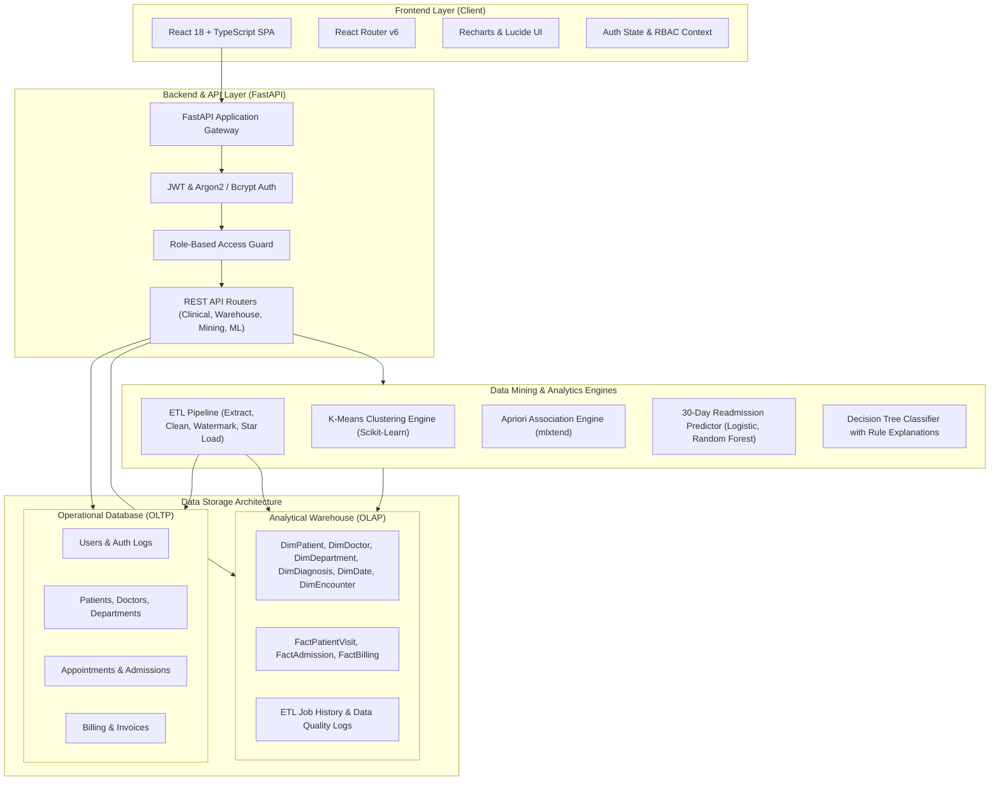
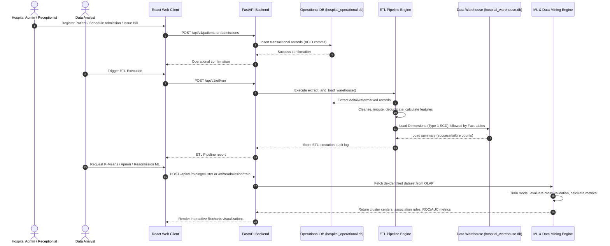

# System Architecture: Hospital Data Warehouse and Patient Analysis

## 1. Architectural Overview

The **Hospital Data Warehouse and Patient Analysis** platform is designed using a multi-tiered, separated-concern architecture. It integrates operational clinical management, asynchronous ETL processing, dimensional analytical data warehousing, and machine learning/data mining analytical pipelines into a cohesive single-page application.

---

## 2. Detailed Data Flow Architecture

The data lifecycle transitions from operational event generation to dimensional warehousing and machine learning models:

---

## 3. Layer Separation & Security Boundaries

1. **Presentation Layer**:
   - Single Page Application built on React 18, Vite, TypeScript, and Tailwind CSS.
   - Client-side route guarding based on user roles (`Administrator`, `Doctor`, `Receptionist`, `Data Analyst`).
   - Secure token handling with optional HttpOnly cookie storage and generic error boundaries.

2. **Service & API Layer**:
   - Built on FastAPI with asynchronous routing and strict Pydantic schemas.
   - Parameterized ORM queries via SQLAlchemy 2.0 preventing SQL injection.
   - Role-Based Access Control (RBAC) enforced via FastAPI dependency injection (`get_current_active_user`, `require_roles`).

3. **Data Storage Layer**:
   - **Operational Store**: Normalized relational schema (3NF) optimized for transactional integrity, foreign key enforcement, and concurrent appointments/admissions.
   - **Analytical Data Warehouse**: Dimensional Star Schema optimized for OLAP aggregations (roll-up, drill-down, slice, dice, pivot).

4. **Analytics & Machine Learning Layer**:
   - Feature engineering isolated from operational identifiers.
   - Data leakage prevention (train/test split separated by unique patient ID to avoid leakage across multiple admissions).
   - Apriori algorithm for market-basket diagnosis co-occurrence mining.
   - Model comparison suite comparing Baseline Dummy, Logistic Regression, Random Forest, and Decision Tree.

---

## 4. Production Scalability Roadmap

For a production deployment, the educational SQLite dual-database setup transitions as follows:
- **Operational Database**: Migrate from SQLite to **PostgreSQL 16** with replication and connection pooling (PgBouncer).
- **Data Warehouse**: Migrate star schema to **ClickHouse**, **Snowflake**, or **Amazon Redshift** for columnar analytical query execution.
- **ETL Orchestration**: Transition the in-process Python pipeline to **Apache Airflow** or **Prefect** with daily/hourly scheduled DAGs.
- **Model Serving**: Store trained Scikit-learn pipelines in an **MLflow** model registry.
