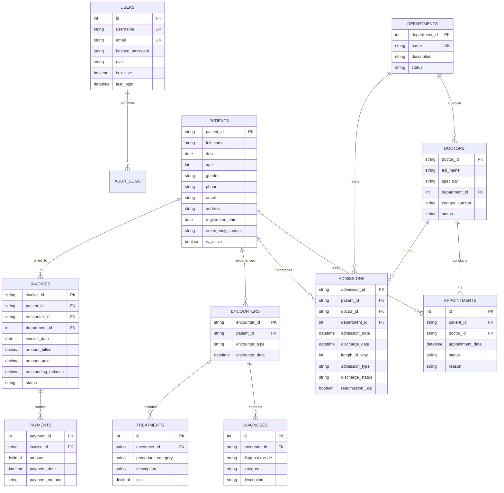
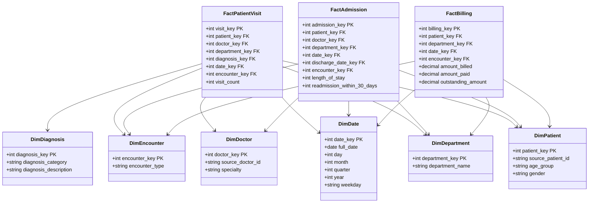

# Database Design & Data Warehouse Schema

## 1. Operational Database Schema (OLTP)

The operational database (`hospital_operational.db`) models daily clinical and administrative operations normalized to Third Normal Form (3NF).

---

## 2. Data Warehouse Dimensional Schema (OLAP - Star Schema)

The analytical data warehouse (`hospital_warehouse.db`) is structured as a **Star Schema** containing 6 dimension tables and 3 central fact tables.

---

## 3. Fact Table Grains and Analytical Measures

1. **`FactPatientVisit`**:
   - **Grain**: One record per individual clinical visit/consultation encounter and primary diagnosis.
   - **Measures**: `visit_count` (additive integer measure, default 1).
   - **Use cases**: Measuring outpatient workload, daily clinic attendance, department-specific consultation frequency.

2. **`FactAdmission`**:
   - **Grain**: One record per completed or ongoing hospital inpatient stay.
   - **Measures**: `length_of_stay` (additive integer in days), `readmission_within_30_days` (binary flag: 1 = readmitted, 0 = non-readmitted).
   - **Use cases**: Monitoring bed occupancy, department length-of-stay averages, 30-day readmission rate calculations.

3. **`FactBilling`**:
   - **Grain**: One record per issued invoice linked to patient encounter.
   - **Measures**: `amount_billed`, `amount_paid`, `outstanding_amount` (fully additive financial decimals).
   - **Use cases**: Revenue analysis, accounts receivable, department collection efficiency, financial forecasting.

---

## 4. Surrogate Keys and Slowly Changing Dimensions (SCD)

- **Surrogate Keys**: Integer auto-incrementing primary keys (`patient_key`, `doctor_key`, `date_key`, etc.) insulate the warehouse from changes in operational source keys (`source_patient_id`), maintain analytical referential integrity, and provide superior join indexing performance.
- **SCD Strategy**:
  - Implements **SCD Type 1 (Overwrite)** for demographic corrections and specialty updates.
  - In a Type 1 implementation, existing dimension attributes are updated in-place when demographic discrepancies are rectified, ensuring operational correctness without preserving erroneous historical records.
  - The architectural documentation details how transitioning to **SCD Type 2 (Historical Versioning with `valid_from`, `valid_to`, `is_current`)** would occur in enterprise production warehouses.
